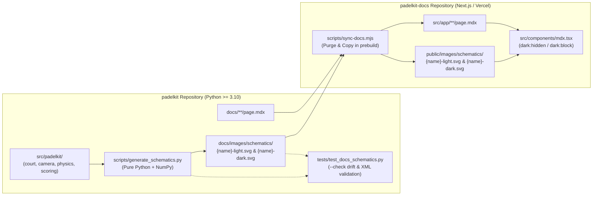

# Zero-Dependency Python SVG Schematic Generator for PadelKit Documentation

*   **Author:** Fidel Echevarria (`@fidelechevarria`)
*   **Status:** Draft
*   **Date:** 2026-11-07

--------------------------------------------------------------------------------

## Overview

PadelKit is an open-source Python library providing 3D padel court geometry (`padelkit.court`), projective camera calibration and lens distortion (`padelkit.camera`), 9D aerodynamic and contact rebound physics (`padelkit.physics`), interactive 3D visualization (`padelkit.viz`), and event-sourced match scoring (`padelkit.scoring`). Its documentation website (`https://padelkit.dev`) uses a decoupled two-repository architecture: Markdown (`.mdx`) content and configuration (`docs.config.json`) live in `padelkit/docs/`, while the Next.js frontend in `padelkit-docs` syncs and renders those files on Vercel via `scripts/sync-docs.mjs`.

This design introduces an offline, zero-dependency Python SVG schematic generator inside `padelkit` (`scripts/generate_schematics.py`) backed directly by `padelkit`'s runtime classes, paired with a theme-aware `<Schematic />` MDX component in `padelkit-docs`. The generator outputs deterministic 2D and 3D vector line diagrams (`-light.svg` and `-dark.svg` pairs) into `padelkit/docs/images/schematics/`, which `sync-docs.mjs` mirrors into `padelkit-docs/public/images/schematics/` during build.

## The Problem

Developers and researchers reading the PadelKit documentation must mentally translate spatial coordinate frames, 17-point 3D landmark definitions, projective camera frustums, optical distortion coefficients, 9D spin-lift vectors, and serving rotations from prose tables and code blocks alone. Specifically:

1.  **Broken and Missing Visual References:** `docs/court-landmark/page.mdx` references ``, a file that does not exist in either repository and returns a 404 error in production. No other documentation page includes explanatory diagrams.
2.  **High Spatial Cognitive Load:** Concepts such as `CoordinateSystem.CENTERED` vs. `CoordinateSystem.CORNER_BASED`, Enclosure Variant 1 (`3.0m` stepped side wall) vs. Variant 2 (`4.0m` uniform side wall), OpenCV (`+Z` forward, `+Y` down) vs. OpenGL (`+Y` up, `-Z` forward) camera axes, Brown-Conrady vs. Fisheye lens distortion, Spindt Magnus lift vs. aerodynamic drag, and Coulomb `SLIDING` vs. `ROLLING` rebound regimes are difficult to verify without visual geometric blueprints.
3.  **Documentation-to-Code Drift:** Existing prose and code examples in `docs/` have already drifted from the codebase: `docs/court-geometry/page.mdx` references non-existent landmark strings (`"NET_CENTER"`, `"TOP_LEFT"`, `"BOTTOM_RIGHT"`) that raise `ValueError` at runtime, and `docs/ball-physics/page.mdx` accesses `b.time` instead of `b.timestamp` on `BounceEvent` (`AttributeError`). Manually drawn diagrams (e.g., exported from Figma or Illustrator) would suffer the same silent drift whenever court dimensions, camera presets, or physics parameters change.
4.  **Theme Isolation in Next.js (`next-themes`):** `padelkit-docs` switches between light and dark themes by toggling `<html class="dark">` (`attribute="class"`). Standard Markdown images (``) isolate the SVG DOM from parent HTML classes and CSS variables, meaning single-file SVGs relying only on `@media (prefers-color-scheme: dark)` fail to switch when a user manually toggles the theme button in the documentation header.
5.  **Strict Packaging & Build Constraints:** The public `padelkit` PyPI package must remain free of heavy plotting or C++ rendering dependencies (`vtk`, `matplotlib`, `cairo`), and the `padelkit-docs` Vercel deployment runs in a pure Node.js container without Python or `numpy`.

To solve these issues, `padelkit` will generate static, deterministic `-light.svg` and `-dark.svg` technical schematics ahead-of-time using its own `Court`, `Camera`, `CameraDistortion`, `BallPhysicsEngine`, and `ServingEngine` calculations and only the Python standard library plus `numpy`.

## Goals

*   **Zero External Rendering Dependencies:** Generate all 2D orthographic and 3D perspective/axonometric SVG schematics using only Python 3.10+ standard library modules (`math`, `xml.etree.ElementTree`, `pathlib`, `dataclasses`, `hashlib`) and `padelkit` (`numpy`, `pandas`). Do not add any dependencies to `pyproject.toml`, and keep `scripts/` excluded from the published PyPI wheel (`packages = ["src/padelkit"]`).
*   **Single Source of Truth from Code:** Compute every coordinate, dimension callout, frustum ray, distorted grid line, and ball trajectory directly from `padelkit` classes so diagrams are mathematically faithful to the library.
*   **CI Drift Verification (`--check`):** Provide a `scripts/generate_schematics.py --check` mode (and a corresponding `pytest` test) that recomputes all schematics in memory and fails with exit code `1` if any committed `.svg` file in `docs/images/schematics/` is missing or out of sync with the codebase.
*   **Synchronized Light/Dark Theme Switching:** Output paired `{name}-light.svg` and `{name}-dark.svg` files and provide a `<Schematic />` MDX component in `padelkit-docs/src/components/mdx.tsx` using Tailwind `block dark:hidden` and `hidden dark:block` classes so diagrams respond immediately to the manual `next-themes` toggle without client-side JavaScript state.
*   **Complete Schematic Coverage Across 4 Core Domains (10 Diagrams / 20 SVG Files):**
    1.  **Court Geometry (3 diagrams):** `court-landmarks-3d` (all 17 numbered landmarks in 3D axonometric view, fixing the broken image on `/court-landmark`), `court-dimensions` (2D plan + 3D side-wall V1/V2 and net height elevation), and `court-coordinate-systems` (`CENTERED` vs. `CORNER_BASED` origin and axes).
    2.  **Camera & Vision (3 diagrams):** `camera-frustum-3d` (3D court with camera presets, frustum pyramid, and World/Camera/Sensor coordinate frames), `camera-sensor-projection` (1920x1080 sensor view with projected 17 landmarks and floor ray intersection), and `camera-distortion-grid` (3-panel comparison of `NONE`, `BROWN_CONRADY`, and `FISHEYE`).
    3.  **Ball Physics (3 diagrams):** `physics-forces-9d` (free-body diagram of velocity, 3D spin vector, gravity, drag, and Spindt Magnus lift), `physics-trajectories` (RK4-simulated side-view comparison of topspin smash, flat drive, and backspin bandeja with wall rebound), and `physics-rebound-regimes` (Coulomb `SLIDING` on glass vs. `ROLLING` grip on turf vs. `DAMPED` on net/fence).
    4.  **Scoring & Serving (1 diagram):** `serving-rotations` (2D court diagram of Deuce/Ad service boxes, diagonal serve trajectories, and the 4-state server/receiver rotation cycle).
*   **Fix Existing Documentation Discrepancies:** Correct the broken landmark reference in `docs/court-landmark/page.mdx`, replace invalid landmark strings (`"NET_CENTER"`, `"TOP_LEFT"`, etc.) in `docs/court-geometry/page.mdx`, fix `b.time` to `b.timestamp` in `docs/ball-physics/page.mdx`, and remove redundant `export const metadata` blocks where present.
*   **Compact, Deterministic SVG Output:** Round all coordinates to 2 decimal places (`:.2f`), omit timestamps, simplify dense RK4 polylines while preserving sharp bounce cusps, and keep every individual `.svg` file under `30 KB`.

## Non-Goals

*   **No Runtime Plotting API in `padelkit`:** The schematic generator is an internal documentation asset builder in `scripts/`, not a public plotting submodule exported to library consumers.
*   **No Python Execution Inside Vercel Builds:** `padelkit-docs` will not invoke Python during `npm run prebuild` or `next build`; it consumes pre-generated static `.svg` files committed in `padelkit/docs/images/schematics/`.
*   **No Photorealistic Rendering or 3D Mesh Assets:** Raytraced lighting, textures, and Blender (`bpy`) synthetic datasets belong to `padelkit[blender]`, not static documentation schematics.
*   **No Animated or Interactive WebGL Widgets:** Interactive 3D playback and skeletal player animations remain the responsibility of `PadelVisualizer` (`padelkit.viz`) and `padelkit-animator`.

## Open Questions

*   None. All repository boundary, theme synchronization, and scope questions were resolved during the brainstorming phase.

## Critical User Journeys (CUJs)

### CUJ 1: Documentation Reader Inspecting 3D Landmarks and Toggling Themes

*   **Given**: A developer visits `https://padelkit.dev/court-landmark` or `https://padelkit.dev/camera-system` in a desktop or mobile browser.
*   **When**: The page loads and the developer clicks the theme toggle button in the top navigation bar to switch between Light and Dark modes, then zooms in on the schematic.
*   **Then**: The `<Schematic />` component immediately switches between `{name}-light.svg` and `{name}-dark.svg` in synchronization with the page background, displaying crisp vector lines, depth-sorted 3D court walls (dashed back edges, solid front edges), and legible callout badges (`1`–`17`) without horizontal overflow or blurry raster pixels.

### CUJ 2: PadelKit Contributor Updating Court or Physics Models

*   **Given**: A contributor clones `padelkit` and modifies a physical constant, camera preset, or court dimension, or edits `scripts/generate_schematics.py`.
*   **When**: The contributor runs `.venv/bin/python scripts/generate_schematics.py` followed by `.venv/bin/pytest`.
*   **Then**: The generator recomputes all 10 schematics (20 `.svg` files) in under `1.0` second using `padelkit`'s updated classes, writes deterministic XML to `docs/images/schematics/`, and the `pytest` drift check (`--check`) passes with zero diff on subsequent runs.

### CUJ 3: Automated Documentation Sync and Build in `padelkit-docs`

*   **Given**: Updated `.mdx` pages and `docs/images/schematics/*.svg` files are present in `padelkit/docs/`.
*   **When**: `npm run build` (which triggers `node scripts/sync-docs.mjs`) runs locally or on Vercel.
*   **Then**: `sync-docs.mjs` purges any stale files in `public/images/schematics/`, copies all fresh `.svg` pairs from `docs/images/schematics/` to `public/images/schematics/`, resolves `<Schematic />` references across all MDX pages, and completes `next build` with zero missing asset warnings and no Python runtime dependency.

## Technical Plan (Architecture)

### 1. System Data Flow & Repository Boundaries

The architecture enforces a strict unidirectional pipeline from `padelkit` (the Python source of truth) to `padelkit-docs` (the Next.js static consumer):

*   **Packaging Isolation:** In `padelkit/pyproject.toml`, `[tool.hatch.build.targets.wheel]` defines `packages = ["src/padelkit"]`. Neither `scripts/generate_schematics.py` nor `docs/images/schematics/*.svg` is bundled into the published PyPI wheel.
*   **Zero Vercel Python Dependency:** Because all generated `.svg` files are committed to `padelkit/docs/images/schematics/`, Vercel builds `padelkit-docs` using only Node.js (`scripts/sync-docs.mjs`).

### 2. SVG Schematic Engine (`padelkit/scripts/generate_schematics.py`)

The generator is implemented as a self-contained Python script structured around four internal components:

#### A. Theme Palette Tokens (`ThemePalette`)

Each schematic is rendered twice—once with `LIGHT_PALETTE` and once with `DARK_PALETTE`—using hex colors aligned with the Tailwind CSS v4 zinc/emerald/sky palette in `padelkit-docs`:

| Token | Light Mode (`-light.svg`) | Dark Mode (`-dark.svg`) | Purpose |
| :--- | :--- | :--- | :--- |
| `bg_canvas` | `#f8fafc` (`slate-50`) | `#090d16` (`slate-950`) | Outer schematic frame background |
| `bg_panel` | `#ffffff` (`white`) | `#0f172a` (`slate-900`) | Inner viewport / sub-panel fill |
| `border` | `#e2e8f0` (`slate-200`) | `#1e293b` (`slate-800`) | Panel and card stroke |
| `grid_line` | `#e4e4e7` (`zinc-200`) | `#27272a` (`zinc-800`) | Background metric grid / reference lines |
| `court_floor` | `#f1f5f9` (`slate-100`) | `#111c2d` (muted navy) | Court turf surface fill |
| `court_line_fg` | `#0f172a` (`slate-900`) | `#f8fafc` (`slate-50`) | Primary foreground court lines & walls |
| `court_line_bg` | `#94a3b8` (`slate-400`) | `#475569` (`slate-600`) | Occluded / background dashed court edges |
| `text_primary` | `#09090b` (`zinc-950`) | `#f4f4f5` (`zinc-100`) | Primary titles, dimensions, axis labels |
| `text_muted` | `#52525b` (`zinc-600`) | `#a1a1aa` (`zinc-400`) | Secondary annotations and coordinates |
| `accent_primary` | `#059669` (`emerald-600`) | `#34d399` (`emerald-400`) | Primary highlights, floor landmarks, rolling regime |
| `accent_secondary` | `#0284c7` (`sky-600`) | `#38bdf8` (`sky-400`) | Camera frustums, back-wall landmarks, Magnus lift |
| `accent_tertiary` | `#d97706` (`amber-600`) | `#fbbf24` (`amber-400`) | Dimension arrows, spin vectors, sliding regime |
| `accent_danger` | `#e11d48` (`rose-600`) | `#fb7185` (`rose-400`) | Aerodynamic drag, net/fence damped regime, origin markers |

#### B. Declarative SVG Primitive Builder (`SvgCanvas`)

`SvgCanvas` builds an `xml.etree.ElementTree` DOM tree with strict formatting invariants:
*   **Coordinate Quantization:** Every floating-point attribute (`x`, `y`, `x1`, `y1`, `cx`, `cy`, `r`, and `<path d="...">` coordinates) is formatted via `f"{val:.2f}"`. `NaN` or `inf` values raise a `ValueError` immediately during generation.
*   **Typography & Accessibility:** Root `<svg>` elements define `viewBox="0 0 {width} {height}"`, `width="100%"`, `height="auto"`, `role="img"`, `<title>`, and `<desc>`. Text elements use `font-family="ui-sans-serif, system-ui, -apple-system, sans-serif"` for prose labels and `font-family="ui-monospace, SFMono-Regular, Menlo, Monaco, Consolas, monospace"` for enum identifiers and coordinates.
*   **High-Level Drafting Helpers:**
    *   `draw_line()`, `draw_polyline()`, `draw_polygon()`, `draw_rect()`, `draw_circle()`, `draw_text()`.
    *   `draw_arrow(p1, p2, color, label, bidirectional=False)`: Draws technical dimension or vector arrows using reusable `<defs><marker>` arrowheads.
    *   `draw_callout_badge(x, y, number_or_code, color, label=None, offset=(dx, dy))`: Renders a rounded pill (`<rect rx="6">`) behind monospace text with an optional leader line so labels never collide with underlying wireframe strokes.

#### C. 3D-to-2D Projection, Clipping & Depth-Sorting Pipeline

All 3D schematics project world coordinates `(X, Y, Z)` through `padelkit.camera.Camera` (either a standard preset or a custom `CameraExtrinsics.from_look_at()` viewpoint):

1.  **3D Near-Plane Clipping:** Before calling `camera.project_points()`, any 3D segment `(P_a, P_b)` is transformed into camera coordinates `(X_cam, Y_cam, Z_cam)`. If one endpoint lies behind $Z_{\text{near}} = 0.10\text{m}$, the segment is analytically clipped at $Z_{\text{cam}} = 0.10\text{m}$.
2.  **Painter's Depth Sorting & Hidden-Line Dampening:** 3D court faces (back glass, side glass, metallic mesh panels, net) and wireframe segments are sorted in descending order of their centroid depth $Z_{\text{cam}}$ (back-to-front). Background edges farthest from the camera are rendered first with `stroke=palette.court_line_bg`, `stroke-dasharray="5 4"`, and `stroke-width="1.2"`, while foreground edges are rendered last with `stroke=palette.court_line_fg` and `stroke-width="2.0"`.
3.  **Polyline Subdivision for Optical Distortion:** To render `camera-distortion-grid`, straight 3D court segments and sensor grid lines are linearly subdivided into $N = 48$ intermediate points before calling `Camera.project_points()` with `CameraDistortion.brown_conrady()` or `CameraDistortion.fisheye()`. This captures barrel and fisheye curvature accurately as smooth SVG `<path>` curves.
4.  **Trajectory Cusp Splitting & RDP Simplification:** When rendering simulated `BallTrajectory` objects (`dt = 0.002s`), the point array `trajectory.positions` is split into separate sub-arcs at each `BounceEvent` index. Each sub-arc is simplified in 2D SVG pixel space using the Ramer-Douglas-Peucker algorithm ($\epsilon = 0.50\text{px}$) and rejoined with sharp `L` vertices at the exact bounce coordinates.

### 3. Catalog of Generated Schematics & MDX Placement

| # | Schematic Name (`name`) | ViewBox | PadelKit APIs Used | Target MDX Page(s) | Layout Placement |
| :--- | :--- | :--- | :--- | :--- | :--- |
| 1 | `court-landmarks-3d` | `960 x 540` | `Court.fip_standard()`, `landmarks_3d()`, `CameraExtrinsics.from_look_at()` | `/court-landmark`, `/court` | Full-width prose figure (replaces broken `.png`) |
| 2 | `court-dimensions` | `960 x 520` | `CourtDimensions.fip_standard()` (2D plan + V1 `3.0m` vs V2 `4.0m` side elevation + net profile) | `/court-dimensions`, `/court-geometry` | Full-width prose figure |
| 3 | `court-coordinate-systems` | `960 x 440` | `Court.landmarks_2d(CENTERED)` vs `landmarks_2d(CORNER_BASED)` | `/court-geometry`, `/court` | Full-width prose figure |
| 4 | `camera-frustum-3d` | `960 x 500` | `Camera.broadcast_near()`, `Camera.overhead_zenith()`, `frustum_corners_world()`, `CameraExtrinsics` | `/camera-system`, `/camera`, `/camera-extrinsics` | Full-width prose figure |
| 5 | `camera-sensor-projection` | `900 x 500` | `Camera.broadcast_near()`, `project_court_landmarks()`, `project_pixel_to_plane()`, `CameraIntrinsics` | `/camera-system`, `/camera-intrinsics` | `<Col sticky>` or Full-width |
| 6 | `camera-distortion-grid` | `960 x 360` | `CameraDistortion.none()`, `brown_conrady()`, `fisheye()`, `Camera.project_points()` ($N=48$ subdivision) | `/camera-distortion` | Full-width 3-column comparison panel |
| 7 | `physics-forces-9d` | `900 x 420` | `BallState.from_shot()`, `BallPhysicsEngine` aerodynamic drag + Spindt Magnus lift equations | `/ball-physics`, `/ball-state` | Full-width prose figure |
| 8 | `physics-trajectories` | `960 x 440` | `BallPhysicsEngine().simulate()` comparing topspin smash (`+2200 RPM`), flat drive (`0 RPM`), and backspin bandeja (`-1800 RPM`) | `/ball-physics`, `/ball-physics-engine` | Full-width prose figure |
| 9 | `physics-rebound-regimes` | `960 x 380` | `BallPhysicsEngine` impulse contact model (`ContactRegime.SLIDING`, `ROLLING`, `DAMPED`) | `/ball-physics`, `/physics-parameters` | Full-width 3-column comparison panel |
| 10 | `serving-rotations` | `960 x 440` | `ServingEngine.calculate_serving_state()`, `Court.landmarks_2d()` | `/serving-state`, `/scoring-system` | Full-width prose figure |

### 4. Frontend MDX Component & Build Sync (`padelkit-docs`)

1.  **`<Schematic />` Component (`padelkit-docs/src/components/mdx.tsx`):**
    Exports a typed `Schematic` component available globally across all `.mdx` files without manual imports:
    *   Accepts `name: string`, `alt?: string`, `caption?: string`, and `className?: string`.
    *   Renders a `<figure>` container styled with `my-8 overflow-hidden rounded-2xl border border-zinc-200/80 bg-zinc-50/50 p-3 dark:border-zinc-800/80 dark:bg-zinc-900/40`.
    *   Inside `<figure>`, renders two `` tags:
        *   ``
        *   ``
    *   Additionally updates the default `img` MDX override so that any standard markdown image referencing `/images/schematics/{name}.svg` or `/images/court-landmarks-3d.png` resolves cleanly.
2.  **Asset Synchronization (`padelkit-docs/scripts/sync-docs.mjs`):**
    Updates lines 34–44 of `sync-docs.mjs` so that before copying `sourceImagesPath` (`docs/images/`) into `publicImagesPath` (`public/images/`), any existing `public/images/schematics` directory is removed (`rm -rf`) and recreated, preventing orphaned SVGs when schematics are renamed.

### 5. CLI & Automated Verification (`padelkit`)

*   **CLI Flags (`scripts/generate_schematics.py`):**
    *   Default (`python scripts/generate_schematics.py`): Generates all 20 `.svg` files into `docs/images/schematics/`.
    *   `--out-dir <path>`: Overrides the output directory.
    *   `--check`: Generates all 20 `.svg` strings in memory, verifies XML well-formedness via `ElementTree.fromstring()`, checks that file size is $< 30\text{ KB}$, and compares SHA-256 hashes against existing files on disk. Exits with code `1` if any file is missing or differs.
*   **Pytest Suite (`tests/test_docs_schematics.py`):**
    Imports `scripts/generate_schematics.py` and runs the `--check` verification and XML/bounds assertions as part of `.venv/bin/pytest`.

## Alternatives Considered

### Alternative A: Heavy 3D / Scientific Rendering Libraries (`VTK`, `PyVista`, `Matplotlib`, `Cairo`)

*   **Pros**: Built-in 3D scene graphs, axis plotting helpers, and automatic polygon rasterization/vectorization.
*   **Cons**: `VTK` and `PyVista` require hundreds of megabytes of C++ shared libraries (`OpenGL`, `EGL`, `OSMesa`, `X11`) that frequently fail in headless CI environments. `Matplotlib` outputs verbose, deeply nested `<g>` and `<path>` DOM structures (`100 KB+` per diagram) with embedded font paths that clash with the Tailwind typography in `padelkit-docs`.
*   **Reason for Rejection**: `padelkit.camera.Camera.project_points()` already computes exact 3D-to-2D perspective and orthographic projections using only `numpy`. Adding external C++ rendering stacks introduces dependency bloat without improving mathematical accuracy.

### Alternative B: Single SVG File Relying Only on `@media (prefers-color-scheme: dark)` Inside ``

*   **Pros**: Halves the number of generated `.svg` files (`10` files instead of `20`) and allows standard Markdown `` syntax without a custom MDX component.
*   **Cons**: `padelkit-docs` uses `next-themes` configured with `attribute="class"` (`padelkit-docs/src/app/providers.tsx`), which switches themes by toggling `<html class="dark">`. Because browsers isolate external SVGs loaded via `` from the host document's DOM and CSS classes, internal `@media (prefers-color-scheme: dark)` rules only reflect the operating system preference and ignore manual clicks on the website's theme toggle button.
*   **Reason for Rejection**: Causes unreadable low-contrast diagrams whenever a user manually selects Light mode on a Dark-mode OS (or vice versa). Paired `-light.svg` / `-dark.svg` files toggled via Tailwind's `block dark:hidden` / `hidden dark:block` in `<Schematic />` stay synchronized with `next-themes`.

### Alternative C: Running the Python Generator During `next build` on Vercel or Storing It Inside `padelkit-docs`

*   **Pros**: Keeps the generator script inside the private frontend repository (`padelkit-docs`) and regenerates SVGs on the fly during deployment.
*   **Cons**: Vercel builds `padelkit-docs` inside a Node.js runtime where Python, `uv`, `numpy`, `pandas`, and the `padelkit` library source are unavailable (`scripts/sync-docs.mjs` only downloads the `padelkit/docs/` subdirectory via a GitHub tarball). Storing the generator in `padelkit-docs` also splits commits across two repositories whenever a `padelkit` API change updates a schematic.
*   **Reason for Rejection**: Breaks Vercel deployments unless multi-runtime buildpacks are configured, and prevents `padelkit`'s own `pytest` suite from catching documentation diagram drift on pull requests. Keeping `scripts/generate_schematics.py` in `padelkit` (excluded from the PyPI wheel via `packages = ["src/padelkit"]`) avoids both issues.

### Alternative D: Manual Hand-Drawn Vector Diagrams (`Figma` / `Illustrator`)

*   **Pros**: Full artistic control over label placement and visual styling without writing projection code.
*   **Cons**: Coordinates, perspective foreshortening, lens distortion curves, and RK4 spin trajectories are manual approximations rather than true reflections of `padelkit` computations. Updating court dimensions or camera presets requires manual re-exporting.
*   **Reason for Rejection**: Violates the single-source-of-truth requirement and cannot be verified automatically in CI.

### Alternative E: Client-Side Interactive `Three.js` / `D3.js` Widgets for Every Diagram

*   **Pros**: Allows readers to orbit or scrub parameters inline on every documentation page.
*   **Cons**: Browsers enforce a hard limit of `8`–`16` active WebGL contexts per tab, increases JavaScript bundle size and page hydration time, and requires duplicating `padelkit`'s Python physics and distortion equations in TypeScript.
*   **Reason for Rejection**: Interactive 3D visualization is already covered by `PadelVisualizer` on `/visualization-3d`; foundational reference pages need lightweight, instant-loading static schematics.

--------------------------------------------------------------------------------

## Non-Functional Requirements

*   **Performance & Latency**:
    *   **Build-Time Generation Speed:** Generating all 10 schematics (20 `.svg` files, including RK4 trajectory simulations and 48-point lens distortion subdivisions) must complete in `< 1.0` second on a single CPU core.
    *   **Client Payload Size:** Each generated `.svg` file must be `< 30 KB` unminified (`< 8 KB` gzipped) by applying coordinate rounding (`:.2f`) and Ramer-Douglas-Peucker polyline simplification ($\epsilon = 0.50\text{px}$).
*   **Determinism & Git Hygiene**:
    *   Re-running `scripts/generate_schematics.py` without changing model parameters must produce byte-identical `.svg` files (`0` bytes git diff). No wall-clock timestamps, random seeds, or unordered dictionary iterations are permitted.
*   **Rollout & Backward Compatibility**:
    *   To maintain backward compatibility with any external links or cached references to `/images/court-landmarks-3d.png` or standard markdown image tags, `docs/court-landmark/page.mdx` will be updated to use `<Schematic name="court-landmarks-3d" ... />`, and `scripts/generate_schematics.py` will also write a fallback copy at `docs/images/court-landmarks-3d.svg`.

--------------------------------------------------------------------------------

### Additional Resources

*   [`padelkit/AGENTS.md`](file:///home/fidel/Work/padelkit/AGENTS.md) — Architecture and documentation rules for `padelkit`.
*   [`padelkit-docs/KNOWLEDGE.md`](file:///home/fidel/Work/padelkit-docs/KNOWLEDGE.md) — Decoupled Next.js documentation sync architecture.
*   [`padelkit-docs/scripts/sync-docs.mjs`](file:///home/fidel/Work/padelkit-docs/scripts/sync-docs.mjs) — Prebuild sync pipeline copying `docs/images/` to `public/images/`.
*   [`padelkit-docs/src/components/mdx.tsx`](file:///home/fidel/Work/padelkit-docs/src/components/mdx.tsx) — Custom MDX component registry.

### Future Improvements

*   **Particle Filter & State Estimation Schematics (`padelkit.tracking`):** Once the bootstrap particle filter and Rauch-Tung-Striebel (`RTS`) backward smoother are implemented, extend `scripts/generate_schematics.py` with a `tracking-particle-filter` diagram showing 2D detection rays, 3D particle clouds, and smoothed trajectory covariance envelopes.
*   **Animated SVG / Lottie Stroke Keyframes:** When `padelkit-animator` integration matures, add optional CSS stroke-dashoffset keyframes for illustrating temporal rally progression in guide headers.

--------------------------------------------------------------------------------

## Detailed Implementation Plan

### Target Files to Create/Modify

#### 1. `padelkit/scripts/generate_schematics.py` ([Create])

*   **Type / Scope**: Python CLI Script & Zero-Dependency SVG Generator (`padelkit` repository, excluded from PyPI wheel).
*   **Proposed Changes**:
    *   **Rationale**: Serves as the single ahead-of-time generator that computes all 10 schematics (20 `.svg` files) directly from `padelkit` domain classes using only the Python standard library and `numpy`.
    *   **Data Structures & Interfaces**:
        *   `ThemePalette` frozen dataclass holding hex color tokens (`mode: Literal["light", "dark"]`, `bg_canvas`, `bg_panel`, `border`, `grid_line`, `court_floor`, `court_line_fg`, `court_line_bg`, `text_primary`, `text_muted`, `accent_primary`, `accent_secondary`, `accent_tertiary`, `accent_danger`) with module constants `LIGHT_PALETTE` and `DARK_PALETTE`.
        *   `SvgCanvas(width: int, height: int, title: str, desc: str, palette: ThemePalette)`: Declarative XML builder formatting all numeric attributes to `:.2f`, rejecting `NaN`/`inf`, and exposing `add_defs_markers()`, `rect()`, `line()`, `polyline()`, `polygon()`, `circle()`, `path()`, `text()`, `dimension_arrow()`, `callout_badge()`, and `to_xml_string() -> str`.
        *   **3D & Curve Math Helpers**:
            *   `clip_segment_near_plane(p1_cam: np.ndarray, p2_cam: np.ndarray, z_near: float = 0.10) -> tuple[np.ndarray, np.ndarray] | None`: Clips 3D segments in camera space prior to perspective projection.
            *   `project_polyline_3d(camera: Camera, points_3d: np.ndarray, subdivide: int = 1) -> np.ndarray`: Subdivides segments into `subdivide` collinear points, clips against `z_near`, and projects to 2D sensor/viewport coordinates via `camera.project_points()`.
            *   `rdp_simplify_2d(points_2d: np.ndarray, epsilon: float = 0.50) -> np.ndarray`: Ramer-Douglas-Peucker polyline reduction in 2D SVG pixel space.
            *   `simplify_trajectory_preserve_cusps(positions_2d: np.ndarray, bounce_indices: Sequence[int], epsilon: float = 0.50) -> np.ndarray`: Splits trajectories at bounce indices, runs `rdp_simplify_2d` on each continuous flight segment, and rejoins them so bounce points remain sharp vertices.
        *   **10 Diagram Generator Functions** (each signature `(palette: ThemePalette) -> str`):
            1.  `render_court_landmarks_3d(palette) -> str`
            2.  `render_court_dimensions(palette) -> str`
            3.  `render_court_coordinate_systems(palette) -> str`
            4.  `render_camera_frustum_3d(palette) -> str`
            5.  `render_camera_sensor_projection(palette) -> str`
            6.  `render_camera_distortion_grid(palette) -> str`
            7.  `render_physics_forces_9d(palette) -> str`
            8.  `render_physics_trajectories(palette) -> str`
            9.  `render_physics_rebound_regimes(palette) -> str`
            10. `render_serving_rotations(palette) -> str`
        *   **CLI Entrypoint (`main(argv: Sequence[str] | None = None) -> int`)**:
            *   Supports `--out-dir <Path>` (defaults to `padelkit/docs/images/schematics`) and `--check` (verifies in-memory SHA-256 hashes, XML validity, and `< 30 KB` size limit against disk files without writing).

#### 2. `padelkit/docs/images/schematics/*.svg` ([Create])

*   **Type / Scope**: Static Vector SVG Assets (20 paired files in `padelkit/docs/images/schematics/` plus 1 fallback file `padelkit/docs/images/court-landmarks-3d.svg`).
*   **Proposed Changes**:
    *   **Rationale**: Provides the versioned static vector diagrams consumed by `padelkit-docs/scripts/sync-docs.mjs` so Vercel builds require zero Python runtime execution.
    *   **Files Created**:
        *   `court-landmarks-3d-light.svg`, `court-landmarks-3d-dark.svg`
        *   `court-dimensions-light.svg`, `court-dimensions-dark.svg`
        *   `court-coordinate-systems-light.svg`, `court-coordinate-systems-dark.svg`
        *   `camera-frustum-3d-light.svg`, `camera-frustum-3d-dark.svg`
        *   `camera-sensor-projection-light.svg`, `camera-sensor-projection-dark.svg`
        *   `camera-distortion-grid-light.svg`, `camera-distortion-grid-dark.svg`
        *   `physics-forces-9d-light.svg`, `physics-forces-9d-dark.svg`
        *   `physics-trajectories-light.svg`, `physics-trajectories-dark.svg`
        *   `physics-rebound-regimes-light.svg`, `physics-rebound-regimes-dark.svg`
        *   `serving-rotations-light.svg`, `serving-rotations-dark.svg`

#### 3. `padelkit/tests/test_docs_schematics.py` ([Create])

*   **Type / Scope**: Pytest Unit & Drift Verification Test Suite (`padelkit`).
*   **Proposed Changes**:
    *   **Rationale**: Guarantees that any change to `padelkit` court geometry, camera math, physics constants, or serving logic that alters schematic output is caught during `.venv/bin/pytest`.
    *   **Test Cases**:
        *   `test_all_schematics_up_to_date()`: Invokes `generate_schematics.main(["--check"])` and asserts return code `0`.
        *   `test_schematics_xml_well_formed_and_bounded()`: Parses all 20 `.svg` files via `xml.etree.ElementTree.fromstring()`, asserts valid `viewBox`, `<title>`, and `<desc>` elements, verifies no `NaN` or `inf` substrings exist, and checks each file size is `< 30_720` bytes.

#### 4. `padelkit-docs/src/components/mdx.tsx` ([Modify])

*   **Type / Scope**: TypeScript React MDX Component Registry (`padelkit-docs`).
*   **Proposed Changes**:
    *   **Rationale**: Exposes `<Schematic />` globally to all `.mdx` files and binds theme switching to Tailwind's `.dark` class (`next-themes`) via `block dark:hidden` and `hidden dark:block`.
    *   **Interface**:
        *   Define `interface SchematicProps { name: string; alt?: string; caption?: string; className?: string }`.
        *   Export `function Schematic({ name, alt, caption, className }: SchematicProps)` rendering a `<figure>` card containing both `/images/schematics/${name}-light.svg` (`block h-auto w-full dark:hidden`) and `/images/schematics/${name}-dark.svg` (`hidden h-auto w-full dark:block`), plus an optional `<figcaption>`.

#### 5. `padelkit-docs/scripts/sync-docs.mjs` ([Modify])

*   **Type / Scope**: Node.js Prebuild Synchronization Script (`padelkit-docs`).
*   **Proposed Changes**:
    *   **Rationale**: Prevents orphaned `.svg` files in `padelkit-docs/public/images/schematics/` when diagrams are renamed or removed in `padelkit/docs/images/schematics/`.
    *   **Behavioral Logic**: Before copying `sourceImagesPath` (`src/app/images`) into `publicImagesPath` (`public/images`), remove `join(publicImagesPath, 'schematics')` recursively if it exists, then copy fresh assets and remove `sourceImagesPath`.

#### 6. `padelkit/docs/court-landmark/page.mdx` ([Modify])

*   **Type / Scope**: MDX Documentation Page (`padelkit`).
*   **Proposed Changes**:
    *   **Rationale**: Fixes the broken `/images/court-landmarks-3d.png` 404 image reference and removes the redundant top-level `export const metadata` block.
    *   **Behavioral Logic**: Replace line 43 (``) with `<Schematic name="court-landmarks-3d" alt="3D Padel Court Landmarks (1-17)" caption="Standard 17 FIP court landmarks: floor points 1–13 (Z = 0.0m) and elevated back-wall corners 14–17 (Z = 4.0m)." />`.

#### 7. `padelkit/docs/court-dimensions/page.mdx` ([Modify])

*   **Type / Scope**: MDX Documentation Page (`padelkit`).
*   **Proposed Changes**:
    *   **Rationale**: Adds visual blueprint support for `CourtDimensions` (`length`, `width`, `service_line_distance_from_back`, `back_wall_height`, `side_wall_height` V1 vs V2, `net_height_center`, `net_height_posts`) and removes top-level `export const metadata`.
    *   **Behavioral Logic**: Insert `<Schematic name="court-dimensions" ... />` after the lead paragraph and properties list.

#### 8. `padelkit/docs/court-geometry/page.mdx` ([Modify])

*   **Type / Scope**: MDX Documentation Page (`padelkit`).
*   **Proposed Changes**:
    *   **Rationale**: Fixes runtime `ValueError` caused by outdated landmark strings (`"NET_CENTER"`, `"TOP_LEFT"`, `"TOP_RIGHT"`, `"BOTTOM_LEFT"`, `"BOTTOM_RIGHT"`), adds the `#coordinate-systems` section referenced by `/court`, removes top-level `export const metadata`, and embeds the court dimensions and coordinate systems schematics.
    *   **Behavioral Logic**:
        *   Embed `<Schematic name="court-dimensions" ... />` under `## The CourtDimensions model`.
        *   Add `## Coordinate Systems` (`CoordinateSystem.CENTERED` vs `CoordinateSystem.CORNER_BASED`) with `<Schematic name="court-coordinate-systems" ... />`.
        *   Update `court.point("NET_CENTER")` to `court.point("center")` (`CourtLandmark.CENTER`) and update `court.landmarks_2d()` output keys to lowercase official keys (`"floor_near_left"`, `"center"`, `"net_left"`, etc.).

#### 9. `padelkit/docs/court/page.mdx` ([Modify])

*   **Type / Scope**: MDX Documentation Page (`padelkit`).
*   **Proposed Changes**:
    *   **Rationale**: Removes top-level `export const metadata` and adds visual references for `landmarks_2d()` and `landmarks_3d()`.
    *   **Behavioral Logic**: Embed `<Schematic name="court-coordinate-systems" ... />` in `## List 2D landmarks` and `<Schematic name="court-landmarks-3d" ... />` in `## List 3D landmarks`.

#### 10. `padelkit/docs/camera-system/page.mdx`, `padelkit/docs/camera/page.mdx`, `padelkit/docs/camera-extrinsics/page.mdx`, `padelkit/docs/camera-intrinsics/page.mdx`, and `padelkit/docs/camera-distortion/page.mdx` ([Modify])

*   **Type / Scope**: MDX Documentation Pages (`padelkit` Camera & Vision section).
*   **Proposed Changes**:
    *   **Rationale**: Visualizes the 3D-to-2D transformation chain (`World -> Camera -> Sensor`), camera preset frustums, intrinsic sensor plane (`fx, fy, cx, cy`), and radial/fisheye distortion grids.
    *   **Behavioral Logic**:
        *   `docs/camera-system/page.mdx`: Embed `<Schematic name="camera-frustum-3d" ... />` under `## Coordinate Systems Overview` and `<Schematic name="camera-sensor-projection" ... />` under `## Quick Example: Projecting the 17 Court Landmarks`.
        *   `docs/camera/page.mdx` & `docs/camera-extrinsics/page.mdx`: Embed `<Schematic name="camera-frustum-3d" ... />`.
        *   `docs/camera-intrinsics/page.mdx`: Embed `<Schematic name="camera-sensor-projection" ... />`.
        *   `docs/camera-distortion/page.mdx`: Embed `<Schematic name="camera-distortion-grid" ... />`.

#### 11. `padelkit/docs/ball-physics/page.mdx`, `padelkit/docs/ball-physics-engine/page.mdx`, `padelkit/docs/ball-state/page.mdx`, and `padelkit/docs/physics-parameters/page.mdx` ([Modify])

*   **Type / Scope**: MDX Documentation Pages (`padelkit` Physics & Dynamics section).
*   **Proposed Changes**:
    *   **Rationale**: Fixes the `b.time` `AttributeError` bug (`BounceEvent.timestamp`) in `docs/ball-physics/page.mdx` and embeds the 9D aerodynamic forces diagram, simulated spin trajectory overlay, and Coulomb contact rebound diagram.
    *   **Behavioral Logic**:
        *   `docs/ball-physics/page.mdx`: Embed `<Schematic name="physics-forces-9d" ... />` under `## 9D State & Aerodynamic Forces`, `<Schematic name="physics-rebound-regimes" ... />` under `## Impulse Contact Dynamics: Sliding vs. Rolling`, and `<Schematic name="physics-trajectories" ... />` under `## Quick Example`; change `b.time` to `b.timestamp` on line 72.
        *   `docs/ball-physics-engine/page.mdx`: Embed `<Schematic name="physics-trajectories" ... />`.
        *   `docs/ball-state/page.mdx`: Embed `<Schematic name="physics-forces-9d" ... />`.
        *   `docs/physics-parameters/page.mdx`: Embed `<Schematic name="physics-rebound-regimes" ... />`.

#### 12. `padelkit/docs/serving-state/page.mdx` and `padelkit/docs/scoring-system/page.mdx` ([Modify])

*   **Type / Scope**: MDX Documentation Pages (`padelkit` Scoring & Core Entities section).
*   **Proposed Changes**:
    *   **Rationale**: Illustrates Deuce/Ad service boxes, diagonal bounce targets, and the 4-state server/receiver rotation cycle across games, and strips top-level `export const metadata` blocks.
    *   **Behavioral Logic**: Embed `<Schematic name="serving-rotations" ... />` in both pages.

#### 13. `padelkit/docs/README.md`, `padelkit/AGENTS.md`, `padelkit/CHANGELOG.md`, and `padelkit-docs/KNOWLEDGE.md` ([Modify])

*   **Type / Scope**: Repository Documentation & Knowledge Base Files.
*   **Proposed Changes**:
    *   **Rationale**: Keeps contributor guides, architectural documentation, and release notes synchronized with the new `<Schematic />` component and `scripts/generate_schematics.py` workflow.

### Verification Plan

*   **Schematic Generation & Drift Check (`padelkit`)**:
    *   Run `.venv/bin/python scripts/generate_schematics.py` in `/home/fidel/Work/padelkit` and verify all 20 `.svg` files are created in `docs/images/schematics/`.
    *   Run `.venv/bin/python scripts/generate_schematics.py --check` and confirm exit code `0`.
*   **Unit Tests (`padelkit`)**:
    *   Run `.venv/bin/pytest` in `/home/fidel/Work/padelkit` (including `tests/test_docs_schematics.py`) and verify 100% pass rate.
*   **Static Analysis & Linting (`padelkit`)**:
    *   Run `.venv/bin/ruff check .` and `.venv/bin/ruff format --check .` in `/home/fidel/Work/padelkit` with zero warnings or errors.
*   **Test Coverage Requirement**:
    *   100% of generated schematics (`10/10` diagrams, `20/20` light/dark SVG files) verified by `tests/test_docs_schematics.py` for XML validity, absence of `NaN`/`inf`, file size `< 30 KB`, and hash determinism.
*   **E2E / Documentation Frontend Build (`padelkit-docs`)**:
    *   Run `npm run build` in `/home/fidel/Work/padelkit-docs` (which executes `node scripts/sync-docs.mjs` followed by `next build`) and verify all 24 documentation routes compile cleanly and all 20 `.svg` files are present under `public/images/schematics/`.

--------------------------------------------------------------------------------

<!-- Provenance: Indicates initial structural drafting via EGM. -->

*Drafted with EGM*

